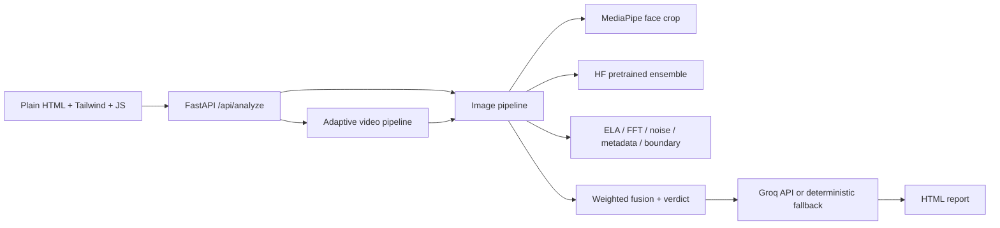

# DeepScan

DeepScan is a deployable, probabilistic deepfake **image and video** screening application. It combines an ensemble of pretrained Hugging Face image classifiers, MediaPipe face analysis, classical forensics (ELA, frequency spectrum, noise residual, metadata, and face-boundary checks), and an optional Groq-written explanation. It does not train or fine-tune models.

## Architecture



## Local run

```powershell
cd deepscan
py -3.11 -m venv .venv
.venv\Scripts\activate
pip install --extra-index-url https://download.pytorch.org/whl/cpu -r requirements.txt
copy .env.example .env
uvicorn app.main:app --host 0.0.0.0 --port 7860 --workers 1
```

Open http://localhost:7860. The first analysis downloads configured Hugging Face models. If a model cannot load, it is skipped and the result states the limitation. Set `GROQ_API_KEY` to enable the AI summary; optionally set `GROQ_MODEL` (default `openai/gpt-oss-120b`, selected because it is currently available to the configured Groq account). Without a key, or if Groq fails, DeepScan uses a deterministic summary and marks it as a fallback.

The requirements file uses the official CPU-only PyTorch wheel index. The explicit install command above is intentional and avoids pulling a CUDA build on Windows or in Docker. Verify the environment with:

```powershell
pip check
python -c "import torch, transformers, cv2, mediapipe, numpy, scipy; print('ok')"
```

## Docker

```powershell
docker compose up --build
# or
docker build -t deepscan .
docker run --rm -p 7860:7860 --env-file .env deepscan
```

The image exposes port 7860, installs only the required headless OpenCV/MediaPipe runtime libraries, preloads available models during the build, and runs as a non-root user. Use one worker because each worker owns a copy of the detector ensemble. Analysis concurrency is limited with `DEEPSCAN_MAX_CONCURRENT_ANALYSES=1` by default.

## Deployment

For Hugging Face Spaces, create a Docker Space, push this folder, and configure `GROQ_API_KEY` and `GROQ_MODEL` as Space secrets. For Render or Railway, deploy the Dockerfile and use port 7860 (or map the platform port to 7860); no source changes are required. Configure `DEEPSCAN_ALLOWED_ORIGINS` with a comma-separated list of trusted browser origins when the UI and API use different domains.

## API

- `GET /api/health`
- `GET /api/ready`
- `POST /api/analyze` with multipart field `file`
- `GET /api/report/{id}` for a downloadable HTML report

Uploads are limited to 100 MB and video analysis samples at most 60 seconds/60 frames. Image bytes are validated before analysis; video uploads are held in a bounded temporary file and deleted in a `finally` block after decoding, including failure paths. Source uploads are not retained by the application. Reports contain derived thumbnails and visualizations so the downloadable report remains useful; configure report storage and retention separately for public deployments. Reports are written to `reports/`.
Analysis requests are limited to 30 per client per 60 seconds by default. Tune
`DEEPSCAN_RATE_LIMIT_REQUESTS` and `DEEPSCAN_RATE_LIMIT_WINDOW_SECONDS` for a
trusted internal deployment. The limiter is intentionally in-memory and
single-process; public multi-instance deployments should add platform-level
rate limiting or an API gateway.
Derived reports and disk-cache entries are automatically removed after
`DEEPSCAN_REPORT_RETENTION_HOURS` (24 hours by default). Set it to `0` only
when an external retention policy manages the report directory. The in-memory
response cache is bounded by `DEEPSCAN_MAX_MEMORY_CACHE_ENTRIES`.

## Performance

DeepScan records per-request timings in the API response under `timings` and logs
the same dictionary. It includes model loading, face detection, each detector
inference, each forensic signal, video decoding/batching, summary generation,
and the total. Models and MediaPipe resources are loaded once during FastAPI
startup and receive a warm-up inference before requests are accepted.

The CPU path batches TTA variants and sampled video frames, uses
`torch.inference_mode()`, reuses decoded images, downsizes analysis images whose
longest side exceeds 1536 pixels, and compresses visualization payloads to
moderate-quality WebP (maximum 800 pixels). Repeated uploads can use the
in-memory SHA-256 cache; set `DEEPSCAN_DISK_CACHE=1` to also persist JSON
responses in `reports/`.

Configurable performance flags:

| Variable | Default | Purpose |
|---|---:|---|
| `DEEPSCAN_TORCH_NUM_THREADS` | `min(4, CPU count)` | PyTorch CPU thread count |
| `DEEPSCAN_VIDEO_BATCH_SIZE` | `4` | Sampled video frames per detector batch |
| `DEEPSCAN_MAX_CONCURRENT_ANALYSES` | `1` | RAM/CPU safety limit |
| `DEEPSCAN_ENABLE_DYNAMIC_INT8` | `0` | Optional CPU Linear-layer int8 quantization |
| `DEEPSCAN_DISK_CACHE` | `0` | Persist SHA-256 response cache |

On the benchmark machine (12 logical CPUs, CPU-only Torch), a cold startup
including model load/warm-up was about 15–20 seconds, while a warm image
analysis was about 3.8 seconds. A synthetic 20-second, 10 FPS video sampled
40 frames in about 120 seconds with the current three-detector ensemble.
These are baseline engineering measurements, not accuracy claims. The
`eval/` harness remains the source of truth for score/verdict regression; no
calibration or quantization setting should be enabled without checking its
before/after scores on a labeled held-out set.

The final API smoke test returned a 44.6 KB compressed JSON response and the
single-worker process used about 1.58 GB resident memory after model warm-up.
Repeated identical uploads returned in about 51 ms from the in-memory cache.

## Limitations

Results are probabilistic, not proof. The pretrained ensemble output is a model probability only when its label mapping and optional calibration have been validated. ELA, FFT, noise, metadata, and boundary values are heuristic suspicion indices; they are not fake probabilities. In particular, noise comparison is marked unavailable when either region has too little measurable residual variation, because dividing by a near-zero background residual can otherwise saturate ordinary images at 100%.

The final score is a weighted heuristic index. The ensemble has the largest configured weight; correlated visual forensic cues are dampened, and unavailable signals are excluded rather than treated as evidence of authenticity. The existing thresholds are unchanged: below 30 is `Likely Real`, 30 through 71.99 is `Inconclusive`, and 72 or above is `Likely Deepfake`. Low-quality, missing-detector, or materially contradictory inputs can abstain to `Inconclusive`. Pretrained detectors can generalize poorly to unseen generators, heavy compression, screenshots, or low-resolution media. Metadata can be stripped, faces can be absent, and classical signals can be affected by ordinary editing. Preserve the original file and seek provenance or expert review for high-stakes decisions.

## Tests

```powershell
pytest
```

## Evaluation and calibration

Add labeled files without changing application code:

```text
eval/data/real/       # camera photos and recompressed real images
eval/data/fake/       # AI-generated images and face swaps
eval/data_video/real/
eval/data_video/fake/
```

Run the direct (non-HTTP) evaluation harness:

```powershell
python eval\run_eval.py
```

It writes `eval/results.csv` and reports accuracy, precision, recall, F1, ROC-AUC,
false-positive rate, false-negative rate, expected calibration error, inconclusive
rate, the confusion matrix, and real/fake score distributions for each detector
and forensic signal. It also performs a deterministic 80/20 held-out comparison
for current and explicitly supplied proposed thresholds. Video scores use the
mean plus a top-20% frame score aggregate so one noisy frame cannot decide the
result.

After enough labeled examples are present, fit probability calibration parameters
without training or changing any detector weights:

```powershell
python eval\calibrate.py
python eval\run_eval.py
```

The generated `eval/calibration.json` is optional and contains only per-model
Platt probability mapping parameters fitted on the deterministic training
partition; the held-out partition is excluded. Detector weights, TTA settings,
forensic weights, and verdict thresholds remain configurable in `app/config.py`. To
produce data-driven fusion/threshold suggestions, run:

```powershell
python eval\tune.py
```

It writes `eval/tuning.json`; review the result on a held-out set before copying
values into `app/config.py`. Results are probabilistic and are weaker on
generators or editing workflows not represented in the evaluation set.
